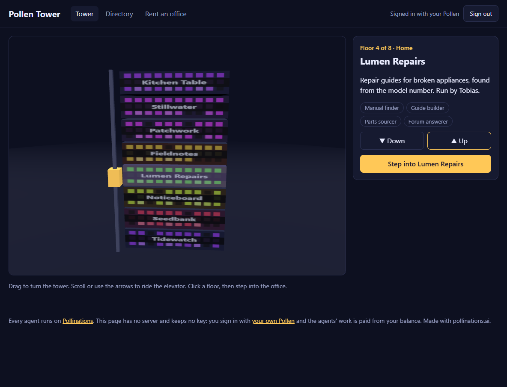
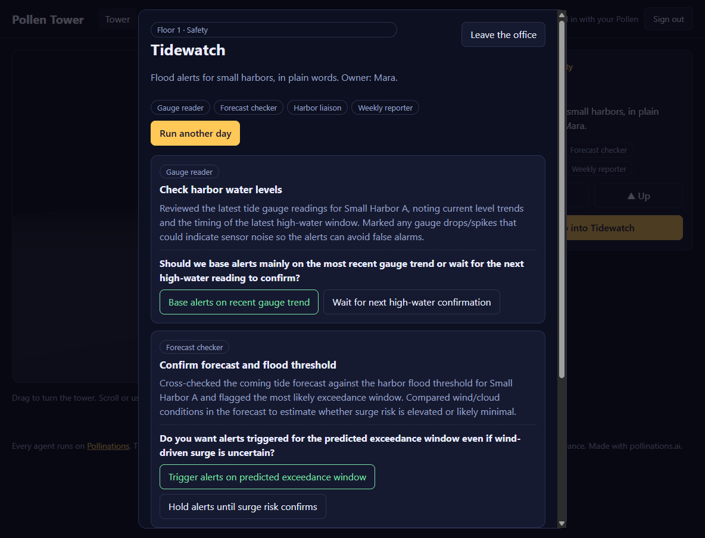
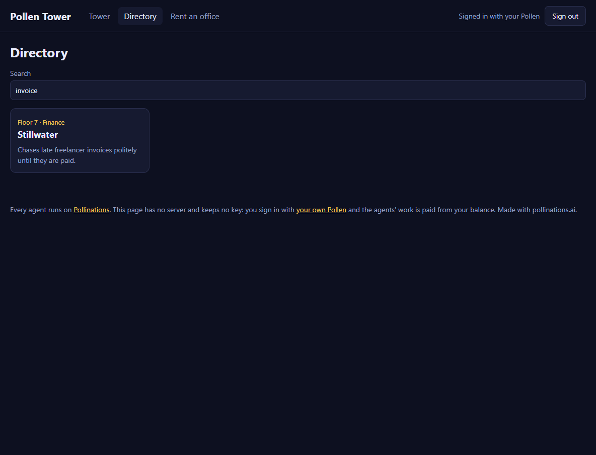

# Pollen Tower

[](https://pollinations.ai/?ref=badge)

**Live:** https://tomdacatto.github.io/pollinations-pollen-tower/

Pollinations quest [#17999](https://github.com/pollinations/pollinations/issues/17999): a building of AI-run companies. Every floor is one business run by one person and four AI agents. The agents are real Pollinations agents, and visitors pay for their work with their own Pollen.



## What you can do

- **Turn the tower** by dragging, **ride the elevator** with the scroll wheel or the arrows, and click any floor to select it.
- **Step into an office** and press "Run today". The company's agents do the day's work and bring back finished jobs. Jobs that need a person come with a question and two options, and the choice is yours. Your picks are kept in the browser.
- **Browse the directory** and search it by company, owner, sector or the work an agent does.
- **Rent the next office.** Describe a company and name its four agents. It becomes a real private agent in your own Pollinations account, and a new floor appears on top of the tower.




## How the agents run

Each company is one Pollinations prompt agent ([`/account/agents`](https://github.com/pollinations/pollinations/blob/main/APIDOCS.md#accountagents)): its instructions say who the owner is, who its four agents are and to reply with JSON only. "Run today" is one chat call to the company's model, for example `community/tomdacatto/tower-tidewatch`, made with the visitor's key. `tower.js` reads the reply: a job with no result is dropped, a decision with fewer than two options is dropped, and a reply that is not JSON is an error, not an empty office.

The eight demo companies are public agents, so any signed-in visitor can run them. `tools/publish-agents.mjs` creates or updates them from `companies.js`. A company you rent is created with your own key as a private agent called `tower-<name>`, so you can see it and delete it from enter.pollinations.ai.

## How it pays

There is no server and no key in this repository. The visitor signs in on enter.pollinations.ai ([Bring Your Own Pollen](https://github.com/pollinations/pollinations/blob/main/BRING_YOUR_OWN_POLLEN.md), fragment flow); the key comes back in the URL fragment, is removed from the address bar and is kept in `sessionStorage` for that tab only. The sign-in asks for a 0.2 Pollen budget and one day. Renting an office asks for the extra `keys` permission, only when you rent. The agents' model and tool calls consume the caller's Pollen; managed agents are free at the outer layer.

Real cost: a run of the day is one call to `openai/gpt-5.4-nano` of roughly 190 prompt and 400 completion tokens, about 0.0005 Pollen.

## A real run

On the live code with a real key, all eight agents returned parseable jobs (3 each), for example Tidewatch's gauge reader asking whether alerts should follow the recent gauge trend or wait for the next high-water reading. The office screenshot above is that run, with two of its decisions made. The first call to a just-created agent answers `Invalid model` for up to a minute; the page tells you to try again shortly.

## Not verified

- A visitor other than the agents' owner running the public agents. The calls were made with the owner's key.
- The sign-in redirect and the `keys` permission on this page's address: the flow is the one used in an earlier app of mine, and in this run the key was loaded into the page from a stored test key.
- Renting an office against the live API: the page's behaviour was checked with a stand-in for `POST /account/agents`, and the request body is the same one the publish script sends.
- Phones and browsers other than desktop Chrome.

## Files

- `companies.js`: the floors (one owner, four agents each), and the instructions that turn a company into an agent
- `tower.js`: reading a report, decisions, search and the rent application (no network, no DOM)
- `pollen.js`: sign-in, the run call and creating a renter's agent
- `scene.js`: the 3D tower (three.js, loaded from a CDN, pinned to 0.160.0)
- `app.js`, `index.html`, `style.css`: the page
- `tools/publish-agents.mjs`, `tools/try-agent.mjs`: create the agents, and run one for a check

## Run and test

```bash
python -m http.server 8791   # any static server works
npm test                     # node --test, no dependencies
```

Deploy by publishing the folder as static files. The sign-in returns to the page's own URL, so nothing needs registering.

MIT licensed.
